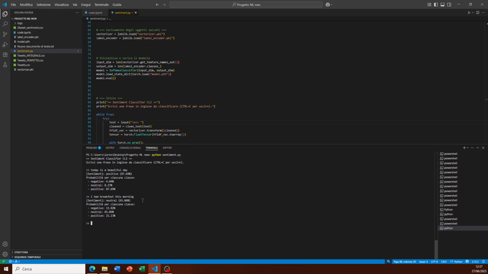

# Sentiment Analysis on Tweets



## Overview
This project tackles a Sentiment Analysis task: the automatic classification of tweets into three categories — **Positive**, **Negative**, and **Neutral**. Starting from a labeled dataset, the goal is to build a classifier capable of predicting the sentiment of a tweet from its text.

The project is organized into the following phases:
1. **Dataset exploration** to understand class distribution and data quality.
2. **Text preprocessing** to remove noise and obtain a clean representation.
3. **Exploratory analysis** of the most frequent words for each class.
4. **Feature extraction** from text using the TF-IDF technique.
5. **Training of Machine Learning models**, including a Softmax classifier built with PyTorch.
6. **Performance evaluation** through classification metrics and the confusion matrix.

This project was developed for the Machine Learning course at the University of Catania, Master's Degree in Computer Science (Academic Year 2024-2025), by Lorenzo Comis and Alessandro Sciacca.

## Key Features
The key features of this project are:

**Text preprocessing**: cleaning of tweets (URLs, mentions, hashtags, repeated characters, emojis) to obtain a normalized representation suitable for vectorization.

**TF-IDF vectorization**: transformation of the cleaned text into numerical features used as input for the classifier.

**Softmax classifier with PyTorch**: a fully connected neural network with Batch Normalization and Dropout, trained to predict the three sentiment classes.

**Command-line demo** (`sentiment.py`): loads the trained model and lets you classify any sentence interactively, showing the predicted class and the probability for each category.

## Repository Contents
- `sentiment_analysis.ipynb` — full pipeline: data loading, preprocessing, training and evaluation.
- `sentiment.py` — CLI script to run the trained classifier interactively.
- `model.pth`, `vectorizer.pkl`, `label_encoder.pkl` — trained model and preprocessing artifacts needed by the CLI.
- `tweets_dataset.csv` — dataset used for training and evaluation.
- `Demo.mp4` — short demo of the CLI classifying sentences in real time.
- `project_report.pdf` / `.docx` — full project report (Italian).

## How to Run
```bash
pip install torch joblib emoji scikit-learn
python sentiment.py
```
